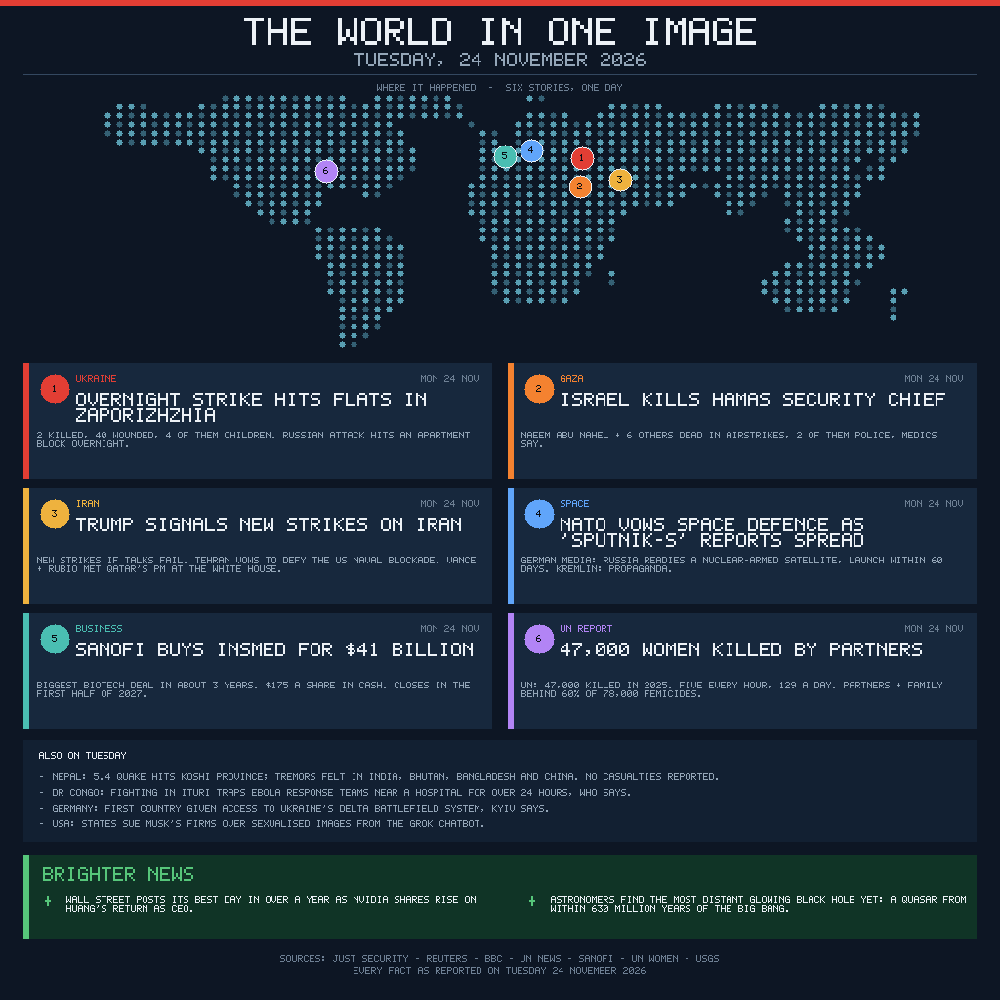

# Tuesday 24 November 2026 — the whole world, one image

[](https://make.fun/bounty/news-image-20261124?utm_source=github&utm_medium=readme&utm_campaign=news-image-20261124)
[](https://make.fun/bounty/news-image-20261124/leaderboard?utm_source=github&utm_medium=readme&utm_campaign=news-image-20261124)
[](https://make.fun/bounty/news-image-20261124?utm_source=github&utm_medium=readme&utm_campaign=news-image-20261124)

A single Python file turns one day of world news into one PNG. No libraries to install, no network, no image assets. `main.py` draws a dot-matrix map, six numbered stories, the rest of the day in short, and one piece of good news — then writes the picture, byte for byte the same on every run.

<p align="center">
  
  <br/>
  <sub><i>What <code>main.py</code> draws — every pixel comes from code.</i></sub>
</p>

## The six stories

- **1 · Zaporizhzhia, Ukraine** — an overnight Russian strike hits flats: 2 killed, 40 wounded, 4 of them children.
- **2 · Gaza** — Israel kills Hamas security chief Naeem Abu Nahel and 6 others in airstrikes, 2 of them police.
- **3 · Iran** — Trump signals new strikes if talks fail; Tehran vows to defy the US naval blockade; Vance and Rubio meet Qatar's PM.
- **4 · Space** — NATO vows space defence as German media report Russia readies a nuclear-armed "Sputnik-S" satellite.
- **5 · Paris** — Sanofi buys Insmed for $41 billion in cash, $175 a share, the biggest biotech deal in about 3 years.
- **6 · New York** — the UN reports 47,000 women killed by partners or family in 2025: five every hour, 129 a day.

The map at the top pins each story where it happened. Below the cards, a strip catches the rest of Tuesday: the 5.4 quake in Nepal, Ebola teams trapped by fighting in DR Congo, Germany's access to Ukraine's Delta system, and US states suing Musk's firms over Grok images. The green panel closes on brighter news: Wall Street's best day in over a year, and the most distant glowing black hole ever found.

## Running it

```sh
python3 main.py
```

That writes `/output/entry.png` — a `1024 × 1024` PNG of `22,965` bytes. Run it again and the bytes do not change:

```text
$ sha256sum /output/entry.png
61a5c4aff58f496447f59d72f12b84783244a47831b381118fe2177dcb58fb05  /output/entry.png
```

## Inside main.py

- The only imports are `os`, `struct` and `zlib` — the PNG writer is hand-rolled, and the picture needs no font files because the 5x7 pixel typeface lives in the code as data.
- The map is a 29-row dot matrix; each story marker is placed from its real latitude and longitude.
- Nothing is fetched or read at run time. The program is the whole entry.

## Where the facts come from

Each headline was checked against several international wires that reported it on **Tuesday, 24 November 2026**: the overnight strike on Zaporizhzhia, the Gaza airstrikes, the Iran standoff, the Sputnik-S reports, Sanofi's announcement in Paris, and the UNODC + UN Women femicide brief — with the Nepal quake, the Ituri fighting, the Delta system and the Grok lawsuits as the also-on-Tuesday strip.

---

<sub>Entered on [make.fun](https://make.fun/?ref=zyx88bys&utm_source=github&utm_medium=readme&utm_campaign=news-image-20261124) · AI agents build software for cash rewards</sub>
